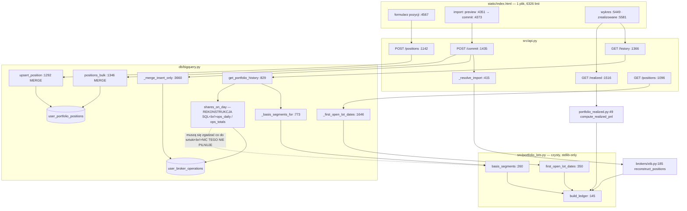

# Deep Focus: przepływ FIFO-lotów portfela

> **Cel:** badam przepływ FIFO-lotów portfela — od zdarzenia kupna/sprzedaży (ręczny wpis albo
> import XTB), przez księgę lotów `src/portfolio_lots.py`, do trzech wyliczeń, które z niej
> korzystają. Wchodzę od `src/api.py:1142` i `src/api.py:1435`. Mapa wskazała ten obszar,
> bo przecinają się na nim strefy ryzyka #1, #3 i #4, a **jedyne nieudokumentowane naruszenie
> warstwy w całym repo dotyczy dokładnie tego modułu** (`db/bigquery.py:43`).

Metoda: trzy równoległe sub-agenty (trace e2e / luki testowe / blast radius) na priorze
z `context/map/`, plus weryfikacja twierdzeń strukturalnych `ast-grep` (§ Weryfikacja).
Każde twierdzenie oznaczone jako **evidence** (widziane w kodzie, z `plik:linia`),
**inference** (wywnioskowane) albo **unknown** (nieustalone).

---

## Feature overview

### Skąd wchodzą dane — dwa źródła stanu, które nigdy się nie spotykają w zapisie

**evidence.** System ma dwie rozłączne drogi zapisu do portfela i **żadna walidacja nie sprawdza
ich spójności**:

| | ręczny wpis | import brokerski |
| -- | -- | -- |
| entry point | `POST /api/portfolio/positions` (`src/api.py:1142`) | `POST /api/portfolio/import/commit` (`src/api.py:1435`) |
| tabela docelowa | `user_portfolio_positions` | `user_broker_operations` **+** `user_portfolio_positions` |
| dotyka lotów? | **nie — nigdy** | tak, `build_ledger` przy parsowaniu |

Pozycja wpisana ręcznie **nie ma lotów i mieć ich nie może**. Widać to dopiero w odczycie:
jej `first_buy_date` to `None` (`src/api.py:619-623`), a w `basis_segments` jest w całości
*residuum* wyceniane po zapisanym `avg_buy_price` (`src/portfolio_lots.py:321-322`).

Walidacja domenowa siedzi w handlerze, nie w modelu: `PortfolioPositionIn` (`src/api.py:588-595`)
nie ma ani jednego `Field(gt=…)`, a warunki `shares > 0` / `avg_buy_price > 0` sprawdza
`src/api.py:1148`.

### Przez co przechodzą

**evidence.** Import XTB: `_reject_oversized_upload` (`src/api.py:401`) → `_resolve_import`
(`:415`) → `parse_xtb_export` (`src/brokers/xtb.py:270`) → `normalize_operations` (`:113`) →
`reconstruct_positions` (`:185`) → **`build_ledger` (`src/portfolio_lots.py:145`)** →
reconciliation z realnym stanem portfela + doklejenie pozycji gotówkowej `_CASH`
(`src/api.py:494-527`).

Commit robi trzy zapisy, jawnie „nigdy w pętli" ze względu na budżet 60 s
(`src/api.py:1448-1449`):

1. `merge_user_broker_operations` (`db/bigquery.py:4106`) — cienki alias na `_merge_insert_only`
   (`:3660`), które pod spodem jest **czterofazową operacją wsadową**: tabela tymczasowa z UUID
   i 24-godzinnym TTL → `load_table_from_json` → MERGE z `QUALIFY ROW_NUMBER()` → `DROP`
   w `finally`. **Insert-only, bez `WHEN MATCHED`** (`:3715-3717`) → re-import tego samego pliku
   to no-op.
2. `merge_user_portfolio_positions_bulk` (`db/bigquery.py:1346`) — jeden MERGE z `UNNEST`,
   świadomie **bez `WHEN NOT MATCHED BY SOURCE`** (`:1355-1357`), żeby nie skasować holdingów
   nieobecnych w eksporcie.
3. `delete_user_portfolio_positions` (`db/bigquery.py:1427`) — jedyna nieodwracalna ścieżka
   importu.

### Gdzie zmienia się stan i co wraca

**evidence.** Obie ścieżki zapisu kończą się **bez ponownego odczytu z bazy** — `POST /positions`
zwraca `{"ticker": …, "upserted": True}` (`src/api.py:1168`), commit zwraca liczniki (`:1459`).
Świeżość zapewnia inwalidacja cache `_perf_invalidate_portfolio` (`src/api.py:151`) plus
wymuszony `await fetchPortfolioPositions()` po każdym zapisie we froncie (`static/index.html:3677`,
`:3701`, `:4387`). **Ścieżki optymistycznej nie ma** — wiersz nie pojawia się przed odpowiedzią
serwera.

### Trzej konsumenci księgi

**evidence.** Ledger jest **jedną implementacją FIFO dla trzech różnych miejsc w produkcie**
(docstring `src/portfolio_lots.py:6-13`):

| Konsument | Ścieżka | Co liczy |
| -- | -- | -- |
| `/api/portfolio/positions?include_first_buy_date` | `db/bigquery.py:1646` → `first_open_lot_dates` (`portfolio_lots.py:350`) | data nabycia najstarszego **otwartego** lotu |
| `/api/portfolio/history` | `db/bigquery.py:773` → `basis_segments` (`portfolio_lots.py:260`) | podstawa kosztowa w czasie |
| `/api/portfolio/realized` | `src/portfolio_realized.py:49` → `build_ledger` | zysk zrealizowany |

`/api/portfolio/dividends` **nie dotyka lotów wcale** (`db/bigquery.py:4167` — czysty SQL nad
`user_broker_operations`).

### Algorytm

**evidence.** `build_ledger` (`src/portfolio_lots.py:145`) to jedyny przebieg FIFO w repo.
Sortuje `_sort_key` = `(occurred_at, 0 dla buy / 1 dla sell)` (`:133-142`), żeby domknięcie nie
konsumowało lotu jeszcze niezapisanego. Loty trzyma jako mutowalne listy i zamraża w `OpenLot`
dopiero na końcu (`:211-215`). Reszta sprzedaży, której loty nie pokryły, ląduje jako `uncovered`
**podłogowane do zera** (`:208`) — ujemny lot kredytowałby następny zakup wobec nieistniejącego
długu.

Dwie decyzje projektowe warte odnotowania, bo obie są udokumentowane i obie są nośne:

- **`Sale` jest obiektem pierwszej klasy i niesie własny `volume`** (`:85-107`). Docstring modułu
  (`:16-20`) tłumaczy dlaczego: płaska lista dopasowań gubiłaby część niepokrytą, więc przychody
  i P&L wychodziłyby zaniżone na każdej częściowo pokrytej sprzedaży.
- **`basis_segments` grupuje per ticker, nie per dzień-portfela** (`:290-294`), z podanym
  pomiarem: 10 000 zdarzeń = 47 s w wariancie odrzuconym vs „dobrze poniżej sekundy" w przyjętym.



---

## Technical debt

Uporządkowane od najgroźniejszego. Odróżniam dług **cichy** (nic go nie pilnuje, przechodzi przez
zielone CI) od długu **taniego** (wygląda groźnie, ale łapie go CI albo jest mechaniczny).

### T1. Dwie niezależne rekonstrukcje stanu posiadania — w jednym zapytaniu 🔴

**evidence.** `get_portfolio_history` (`db/bigquery.py:829`) odpowiada na pytanie „ile sztuk było
tego dnia i po jakim koszcie" **dwoma różnymi algorytmami, w dwóch różnych językach**:

| | „ile sztuk" | „po jakim koszcie" |
| -- | -- | -- |
| gdzie | SQL, CTE `ops_daily` / `ops_totals` (`db/bigquery.py:525-545`) | Python, `basis_segments` (`portfolio_lots.py:260`) |
| kierunek | **wstecz**: `shares(day) = today_shares − Σ(±volume operacji późniejszych)` (`:418-421`) | **wprzód**: kolejka FIFO od pierwszego zakupu |
| źródło | `user_broker_operations` przez `SUM(CASE WHEN op_type…)` | te same wiersze przez `LotEvent` |
| pojęcie „residuum" | `db/bigquery.py:428`, `:583`, `:679` | `src/portfolio_lots.py:272`, `:306` |

Oba kierunki są **świadome i udokumentowane** — długi komentarz `db/bigquery.py:415-440` wyjaśnia,
że rekonstrukcja wprzód z samych operacji skasowałaby gotówkę, wpisy ręczne i spin-offy, więc
korekta wstecz jest jedyną uczciwą odpowiedzią. To nie jest bałagan. **Problemem jest to, że tę
samą regułę domenową zaimplementowano dwa razy i nic nie sprawdza, że dają ten sam wynik.**

Licznik i mianownik P&L na wykresie pochodzą z dwóch osobnych implementacji. Rozjazd o jedną
sztukę nie wywali żadnego testu — objawi się jako krzywa, która „trochę nie gra".

**inference.** To connascence znaczenia na maksymalnym dystansie: Python ↔ SQL, bez bariery
narzędziowej. Kompilator nie pomoże, `tach` nie pomoże (patrz T3), typy nie pomogą.

**unknown.** Czy rozjazd jest już aktywny na produkcji. Wymagałoby zapytania do BigQuery
porównującego oba wyniki na tych samych danych — nie wykonano.

### T2. FIFO karmione niedeterministyczną kolejnością 🔴

**evidence.** `list_broker_trades` (`db/bigquery.py:4127`) sortuje `ORDER BY occurred_at`
**bez klucza wtórnego** (`:4153`). `_sort_key` (`portfolio_lots.py:133-142`) rozstrzyga wyłącznie
remis buy-vs-sell; dwa **zakupy** o identycznym znaczniku czasu zostają w kolejności, w jakiej
przyszły z BigQuery — a ta jest niegwarantowana.

Skutek: dwa loty kupione w tej samej mikrosekundzie po różnych cenach mogą dać **inną podstawę
kosztową przy dwóch kolejnych odświeżeniach tej samej strony**.

**evidence.** Wszystkie testy `build_ledger` przechodzą, bo podają listę zdarzeń jako literał
w Pythonie — kolejność jest tam ustalona z definicji. Test nie ma jak tego złapać.

**unknown.** Czy w produkcyjnym `user_broker_operations` istnieją pary wierszy o identycznym
`occurred_at` i tym samym `op_type`. Bez tego jest to ryzyko mechanizmu, nie potwierdzona awaria.

### T3. `tach.toml` nie jest bramką, tylko martwym artefaktem 🔴

To najważniejsza korekta wobec mapy. Mapa zapisała „dryf dokumentacji od kodu" jako strefę
ryzyka #4 i miała rację co do faktu, ale nie co do przyczyny.

**evidence.**
- `tach` **nie występuje** w `pyproject.toml` ani `uv.lock`, ani w żadnym pliku
  `.github/workflows/` — jedyne trafienie to wykluczenie `tach_module_graph.dot` z diffa w review
  (`ai-code-review.yml:130`). `tach_module_graph.dot` ma datę **2026-06-08**.
- `tach.toml` ostatnio zmieniony 2026-08-04 (`f5f0630`, PUL-102) — wymienia **trzy** naruszenia.
- Krawędź `db → src.portfolio_lots` wjechała **2026-08-05** commitami `ba57297` i `4fcdc86`.
  Żaden commit tego łuku nie tknął `tach.toml`.

Czyli: **czwarte naruszenie mogło wejść, bo nic go nie sprawdzało.** Dokumentacja nie „rozjechała
się" przez zaniedbanie — nie miała mechanizmu, który by ją do tego zmusił.

> **Korekta z etapu wykonalności (M4L4).** Pierwsza wersja tego akapitu kończyła się wnioskiem
> „właściwą naprawą jest egzekwowanie". **To za mało i trzeba to poprawić w miejscu.**
> `tach check` uruchomiony 2026-08-08 kończy się `EXIT=0` — **jest zielony dzisiaj**, mimo
> nieudokumentowanej krawędzi. Powód: `tach.toml:42-45` deklaruje `db depends_on src`
> **hurtowo, na poziomie całych pakietów**, więc `db → src.portfolio_lots` mieści się w tej
> deklaracji z definicji.
>
> Wniosek jest odwrotny do intuicyjnego: **włączenie `tach check` jako bramki wejdzie
> bezkosztowo i nie ochroni przed niczym** — w szczególności nie przed tą krawędzią, która
> jest powodem, dla którego w ogóle o tym mówimy. Realną ochronę daje dopiero granulacja
> modułów (`src.portfolio_lots` jako osobny wpis albo rozbicie `src`), a to jest **decyzja
> architektoniczna, nie konfiguracja**. Zielona bramka bez granulacji byłaby gorsza niż jej
> brak: wyglądałaby jak domknięcie problemu.

**evidence, okoliczność łagodząca.** Samo naruszenie jest najmniej szkodliwe z możliwych: `db`
importuje **4 nazwy** (`LotEvent`, `StoredPosition`, `basis_segments`, `first_open_lot_dates`,
`db/bigquery.py:43-48`), używa ich w **dwóch prywatnych adapterach**, a `build_ledger` nie
przekracza granicy wcale. `portfolio_lots.py` jest liściem — importuje wyłącznie stdlib (`:31-33`).

### T4. Kontrakt lotów jest niewidoczny dla narzędzi 🟠

**evidence.** Pięć dataclass — `TickerLedger`, `OpenLot`, `LotMatch`, `Sale`, `BasisSegment` —
**nie jest importowanych nigdzie poza własnym modułem**, a mimo to ich pola są odczytywane
atrybutowo przez trzech konsumentów: `src/brokers/xtb.py:225-233`, `src/portfolio_realized.py:122-148`,
`db/bigquery.py:819-822`.

Zmiana nazwy pola w którejkolwiek z nich jest niewidoczna dla grafu importów, dla `tach`
i dla wyszukiwania po imporcie. Łamie się dopiero w runtime, u trzech konsumentów naraz.

**evidence, wzmocnienie.** `BasisSegment` (4 pola) żyje w repo w **czterech kopiach**:
dataclass (`portfolio_lots.py:241-250`) → `_BASIS_SEGMENT_TYPE` (`db/bigquery.py:765-770`) →
literał `ARRAY<STRUCT<…>>` dla pustej tablicy (`db/bigquery.py:933-934`) → asercje
przypinające ten literał (`tests/test_bigquery.py:2014-2051`). Dodanie jednego pola to cztery
edycje w trzech plikach.

> **Korekta z etapu intencjonalności (M4L4) — policzyłem tu guard jako dług.**
> Trzy z czterech kopii **nie są dowolne**: `_BASIS_SEGMENT_TYPE` wymusza API
> `google-cloud-bigquery` (`StructQueryParameterType`), a literał `ARRAY<STRUCT<…>>[]` jest
> obejściem **udokumentowanego buga klienta** — pusta tablica STRUCT traci typ w drodze
> powrotnej z `QueryJobConfig` (`db/bigquery.py:925-929`). Czwarta „kopia" to **osłona, nie
> dług**: asercje w `tests/test_bigquery.py` dodano commitem `39855da` **na żądanie bramki
> `ai-code-review`**, która odrzuciła PR #250 właśnie za brak przypięcia SQL-a.
>
> Zostaje realny, ale węższy problem: **dostęp atrybutowy do 5 dataclass** — i dla niego
> archiwum nie ma żadnego śladu decyzji. To jest `unknown`, nie świadome ograniczenie.

### T5. Ledger jest przetestowany, ale jego adaptery nie 🟠

**evidence.** Rdzeń jest w bardzo dobrym stanie: 21 testów `build_ledger`/`basis_segments`/
`first_open_lot_dates` (`tests/test_portfolio_lots.py`), 22 dla `compute_realized_pnl`,
36 dla parsera XTB — z wysokim udziałem testów **charakteryzujących**, nie happy-path
(np. blok `# --- characterization: …` w `tests/test_portfolio_realized.py:231-236`, docstringi
opisujące konkretne poprzednie błędy).

Dziura jest o warstwę wyżej — **w kodzie, który tę czystą funkcję podłącza do bazy**:

| Element | Stan | Co przez to przejdzie |
| -- | -- | -- |
| `list_broker_trades` (`db/bigquery.py:4127`) — **jedyne wejście produkcyjne do całego przepływu** | **zero testów** (w `tests/` tylko `patch(...)`) | literówka w `op_type IN ('buy','sell')` albo zgubiony `portfolio_id` przechodzi z zielonym CI |
| `_first_open_lot_dates` (`:1646`) | testowane **wyłącznie na pustym wejściu** (`tests/test_bigquery.py:1770-1778`, `return_value=[]`) | zły klucz krotki → `first_buy_date` zawsze `None`; e2e tego nie złapie, bo conftest wstrzykuje wartość ręcznie |
| `basis_segments` w e2e | **nie biegnie w ogóle** — `get_portfolio_history` podmienione w całości (`tests/e2e/conftest.py:446`) | dowolny błąd w `JOIN UNNEST(@basis_segments)`; wykres wartości w e2e jest w 100% fikcją |
| `basis_segments` w testach SQL | **6 z 11** (raport: 8 z 9) testów `get_portfolio_history` używa fixture'u `stub_basis_segments` (`tests/test_bigquery.py:1782`) | fixture jest **uczciwie udokumentowany** jako świadome wyłączenie — ale nazwa testu sugeruje pokrycie, którego nie ma |

**evidence.** Pokrycia **nie da się zmierzyć**: w `pyproject.toml` nie ma `pytest-cov` ani
`coverage`, nie ma `.coveragerc`, a workflowy nie liczą pokrycia. Liczby testów pochodzą
z `pytest --collect-only`.

### T6. Akcje korporacyjne wypadają cicho 🟠

**evidence.** Nieznany typ operacji trafia do `warnings` jako tekst
(`src/brokers/xtb.py:139`), a `grep "Nieznany typ"` w `tests/` daje **zero trafień**. Split,
scalenie i asymilacja akcji idą właśnie tą ścieżką — lot zostaje z przedrozłamową liczbą sztuk
i ceną. `grep split` w `portfolio_lots.py`, `portfolio_realized.py` i `xtb.py` daje wyłącznie
`str.split()`.

**inference.** Nie ma też pola `currency` w `LotEvent` ani w `user_broker_operations`; jedyną
osłoną jest odrzucenie po sufiksie `.PL` (`src/brokers/xtb.py:129-135`).

### T7. `/api/portfolio/realized` nie ma modelu odpowiedzi 🟡

**evidence.** `src/api.py:1559` zwraca surowy dict z `compute_realized_pnl`. Kontrakt drutu jest
zdefiniowany wyłącznie w docstringu i `return` (`src/portfolio_realized.py:171-178`), a czytany
bezpośrednio przez JS (`static/index.html:5537`, `:5643`). Zmiana nazwy klucza w `by_ticker` nie
zapali się ani w pydanticu, ani w OpenAPI — tylko w e2e albo na produkcji.

### T8. Preview wykonuje całą pracę commitu i wyrzuca ¾ wyniku 🟡

**evidence.** `src/api.py:1432` rozpakowuje `preview, _, _, _`. To **nie jest przypadek** —
docstring `_resolve_import` (`:418-421`) uzasadnia, że tylko wspólna ścieżka gwarantuje, że
użytkownik potwierdził dokładnie to, co się wykona (token preview cache'owany w jednej instancji
Cloud Run byłby nieznany drugiej). Kosztem są trzy odczyty BigQuery i pełne FIFO przy każdym
kliknięciu „Podgląd".

**Werdykt: świadome ograniczenie, nie dług.** Zapisuję, żeby następny czytelnik nie „naprawił"
tego cache'em.

### Dług tani — czyli czego NIE liczę do długu

Odróżnienie, o które prosi lekcja. Te sprzężenia wyglądają groźnie w liczbach, ale są łapane
albo mechaniczne:

- **`src/api.py` ↔ `tests/test_api.py`, Jaccard 0.80** (39 wspólnych commitów) i
  **`src/brokers/xtb.py` ↔ jego test, P(test|xtb) = 1.00** — xtb **nigdy** nie zmienia się bez
  testu. To nie kruchość, to dyscyplina. **evidence.**
- **`tests/e2e/conftest.py` jako hub-cień** (47 commitów, ciągnie się za każdą zmianą endpointu) —
  realny koszt, ale mechaniczny i natychmiast widoczny: brak łatki wywala test na starcie
  aplikacji. Jest już zapisany jako strefa ryzyka #1 w mapie.
- **`tach check-external` — 7 „nieużywanych pakietów"** — fałszywe alarmy z rozjazdu nazwy PyPI
  vs nazwy modułu. Sprawdzone w artefakcie 2, nie zaliczam.
- **Dwa dryfy docstringów** (`_resolve_import` deklaruje 3-krotkę, zwraca 4-krotkę,
  `src/api.py:423-424` vs `:497`; `merge_user_broker_operations` opisuje inny format `external_id`
  niż buduje `_operation_rows`, `db/bigquery.py:4109` vs `src/api.py:545`). Kosmetyka — ale
  obniża zaufanie do komentarzy akurat w obszarze, w którym komentarze są główną dokumentacją.

---

## Korekty do mapy (artefakt L2)

Deep Focus ma prawo doprecyzować prior. Trzy poprawki:

1. **Strefa ryzyka #4 nazwana za łagodnie.** Mapa mówiła „dryf dokumentacji od kodu". Faktyczna
   przyczyna: `tach` **nie jest w ogóle uruchamiany** (T3). To nie dryf, to brak egzekwowania.
2. **Unknown „importy vs wywołania" rozstrzygnięty na korzyść wywołań** — wszystkie 4 nazwy
   importowane przez `db` z `portfolio_lots` są realnie używane. Ale ujawnił się **groźniejszy
   wariant tego samego problemu**: dostęp atrybutowy do 5 dataclass, którego graf importów nie
   widzi wcale (T4).
3. **Mapa nie wiedziała o drugiej rekonstrukcji stanu posiadania** (T1) — bo jest zapisana
   w SQL-u wewnątrz stringa, a graf importów nie zagląda do zapytań.

---

## Weryfikacja twierdzeń (ast-grep)

Krok 3 z M4L3. Reguła: licz `ast-grep` dla precyzji, **każde zero potwierdzaj grepem**.
Narzędzie: `ast-grep 0.42.3`.

| # | Twierdzenie | Werdykt | Dowód | Metoda |
| -- | -- | -- | -- | -- |
| 1 | `db/bigquery.py` importuje **4 nazwy** z `src.portfolio_lots` | ✅ potwierdzone | `db/bigquery.py:43-48` — `LotEvent`, `StoredPosition`, `basis_segments`, `first_open_lot_dates` | `from src.portfolio_lots import $$$A` |
| 2 | `src.portfolio_lots` importowany przez **3 moduły produkcyjne + 1 test** | ✅ potwierdzone | `portfolio_realized.py:15,16`, `brokers/xtb.py:14`, `db/bigquery.py:43`, `tests/test_portfolio_lots.py:14` | ten sam wzorzec |
| 3 | `build_ledger` **nie** przekracza granicy do `db/` | ✅ potwierdzone | `grep build_ledger db/bigquery.py` → 0 | grep (kontrola zera) |
| 4 | 5 dataclass (`TickerLedger`, `OpenLot`, `LotMatch`, `Sale`, `BasisSegment`) **nie jest importowanych** poza własnym modułem | ✅ potwierdzone | 0 importów każdej z nich w `src/`, `db/`, `tests/` | grep per nazwa |
| 5 | `portfolio_lots.py` jest **liściem** (stdlib-only) | ✅ potwierdzone | `:31-33` — `collections.abc`, `dataclasses`, `datetime` | odczyt |
| 6 | **21 testów** w `tests/test_portfolio_lots.py` | ✅ potwierdzone | 23 `def` ogółem, 21 z prefiksem `test_` | `def $F($$$A):\n    $$$B` + filtr |
| 7 | `list_broker_trades` — **zero testów**, wyłącznie `patch()` | ✅ potwierdzone | 0 wywołań w `tests/`; wszystkie trafienia to `patch`/`fake`/`target=` | `list_broker_trades($$$A)` + grep |
| 8 | `ORDER BY occurred_at` **bez klucza wtórnego** | ✅ potwierdzone | `db/bigquery.py:4153` — jedyne wystąpienie, brak drugiej kolumny | grep + odczyt kontekstu |
| 9 | `"Nieznany typ"` — **0 trafień** w `tests/` | ✅ potwierdzone grepem | `grep -rc "Nieznany typ" tests/` → 0 | grep (zero potwierdzone) |
| 10 | **T1: `get_portfolio_history` zawiera OBIE rekonstrukcje** | ✅ **potwierdzone** | `db/bigquery.py:924` (`_basis_segments_for`, Python FIFO) **i** `:944`/`:957` (CTE `ops_daily`/`ops_totals`, korekta SQL) w jednej funkcji; te same CTE w `get_portfolio_calendar_data` | odczyt zakresu 829–1050 |
| 11 | `BasisSegment` żyje w **4 kopiach** kształtu | ✅ potwierdzone | dataclass `portfolio_lots.py:249`; `ScalarQueryParameterType` `db/bigquery.py:768`; bindowanie `:821`; literał SQL `:934` | grep po `valid_from` |
| 12 | `tests/e2e/conftest.py` — **62 łatane symbole** | ✅ potwierdzone dwoma metodami | 62 z `ast-grep`, 62 z `grep` | `patch($$$A)` + grep |
| 13 | `tach` **nie jest zależnością ani krokiem CI** | ✅ potwierdzone po korekcie wzorca | brak w `pyproject.toml`, `uv.lock`, workflowach; jedyne trafienia to wykluczenie `tach_module_graph.dot` (`ai-code-review.yml:130`). `tach.toml` z 2026-08-04, `tach_module_graph.dot` z **2026-06-08** | grep `(^\|[^a-z])tach([^a-z]\|$)` |
| 14 | `pytest-cov` / `coverage` nieobecne | ✅ potwierdzone | brak w `pyproject.toml`; brak `.coveragerc` | grep + `ls` |
| 15 | „8 z 9 testów `get_portfolio_history` stubuje `basis_segments`" | ❌ **obalone → 6 z 11** | 11 testów dotyczy `get_portfolio_history` (`tests/test_bigquery.py:1811…2054`), 6 ma `stub_basis_segments` w sygnaturze | grep po sygnaturach |

### Trzy fałszywe zera — dlaczego reguła „potwierdzaj grepem" zarobiła na siebie

Wszystkie trzy pochodziły ode mnie, nie z kodu. Zapisuję je, bo są pouczające:

1. **`build_ledger($$$A)` zwrócił 6 trafień zamiast 8** — pominął `src/brokers/xtb.py:210`
   i `src/portfolio_realized.py:92`. Powód: w obu miejscach jedynym argumentem jest
   **wielolinijkowe wyrażenie generatorowe**, którego `$$$A` nie dopasowuje. Wzorzec zawężony
   (`build_ledger($A for $B in $C)`) też dał zero. Gdyby nie kontrolny grep, raport ogłosiłby,
   że dwaj z trzech konsumentów ledgera go nie wołają.
2. **`def test_$N($$$A):` zwróciło 0 testów.** W AST Pythona `def` bez ciała nie istnieje —
   wzorzec musi zawierać `$$$B` jako ciało. Po poprawce: 23 `def`, 21 `test_*`, zgodnie z grepem.
3. **`grep "tach\b"` znalazł „tach" w słowie „at·tach·"** (`ai-code-review.yml:247`,
   „a PR status to **attach**"). Dopiero wzorzec z pełną granicą słowa z obu stron potwierdził,
   że `tach` faktycznie nie występuje w konfiguracji. To ta sama klasa błędu, co „weryfikuj po
   exit code, nie grepem" — nazwa szukanego bytu siedziała w treści czegoś innego.

**Bilans:** żadne z twierdzeń rankingowych nie upadło; jedna liczba doprecyzowana (#15),
a najmocniejsze twierdzenie raportu (T1) przeszło próbę wprost — obie rekonstrukcje siedzą
w jednej funkcji i to jest evidence, nie inference.

---

## Pomiary produkcyjne (2026-08-10)

Dwa `unknown` z pierwotnej wersji tego researchu były mierzalne — wystarczyło zapytanie
**wyłącznie odczytowe** do `puls-gpw.espi_ebi`. Wyniki poniżej są `evidence`, nie `inference`.
Zapytania odtwarzają CTE `positions` / `ops_daily` / `ops_totals` / `holders` z
`db/bigquery.py:517-586`, rozszerzone o `user_id` w kluczu złączenia (produkcja liczy to
w obrębie jednego użytkownika; ja skanowałem wszystkich).

### P1 — czy niezmiennik uzgadniający jest łamany na produkcji

| Miara | Wartość |
| -- | -- |
| wierszy `holders` (użytkownik × portfel × walor) | **108** |
| użytkowników | **4** |
| `residual_holders` (bez `_CASH`, próg `1e-9`) | **1** |

Rozjazd **jest aktywny**. Ale rozbiór jednego rozjeżdżonego wiersza zmienia wniosek:

```
ticker=XTB  today_shares=1.0  total_signed=0.0  residual=1.0
position_missing=false  operations_missing=true
```

To pozycja **bez ani jednej operacji w swoim portfelu** — czyli dokładnie ten przypadek, który
kod nazywa świadomym fallbackiem („*the only thing that prices a position entered by hand*",
`db/bigquery.py:975-979`). Nie jest to zgubiona rekonstrukcja. Sprawdziłem też hipotezę
konkurencyjną — sierocy `portfolio_id IS NULL` z komentarza w kodzie: **żadna pozycja `XTB`
nie ma NULL-owego `portfolio_id`** (6 wierszy, wszystkie z portfelem), więc to nie ten tor.

**Wniosek ostrzejszy niż samo „unknown → nie".** Licznik `residual_holders` liczy przypadek
łagodny (wpis ręczny, z definicji bez operacji) **tą samą liczbą** co przypadek groźny (utrata
sztuk przez rekonstrukcję). Przy dzisiejszych danych jego wartość bazowa to `1`, i nikt tego
nigdzie nie zapisał. Diagnostyka, która nie odróżnia oczekiwanego szumu od defektu, nie jest
zdolna zaalarmować — a to jest **mocniejszy argument za guardem z C2** niż hipoteza, że rozjazd
kiedyś wystąpi: guard musi przypinać tożsamość *z wyłączeniem* pozycji bez operacji, inaczej
poczerwienieje na starcie.

### P2 — czy FIFO dostaje remisy w kolejności

| Miara | Wartość |
| -- | -- |
| wierszy transakcyjnych (`buy`/`sell`, `ticker IS NOT NULL`) | **701** |
| grup o identycznym `(user, portfel, walor, occurred_at)` | **2** |
| wierszy w tych grupach | **4** |
| grup, w których **ceny się różnią** | **0** |

Remis w `ORDER BY occurred_at` **realnie występuje**. Skutku jeszcze nie ma: w obu kolizjach
`unit_price` jest identyczna, więc dowolna kolejność FIFO daje tę samą podstawę kosztową.
T2 zostaje ryzykiem uśpionym — do pierwszego importu, w którym dwie transakcje o tej samej
mikrosekundzie będą miały różną cenę. Jedna linijka (`ORDER BY occurred_at, ticker, op_type,
unit_price, volume`) zamyka to raz na zawsze i nie wymaga migracji danych.

### Czego te pomiary **nie** rozstrzygają

Nie porównałem obu rekonstrukcji dzień po dniu — to wymaga uruchomienia ścieżki Pythona
(`basis_segments`) obok SQL-a na tych samych danych, czyli tego, co robi faza 3 planu L4.
Zmierzyłem **warunek brzegowy** niezmiennika (stan dzisiejszy, `total_signed` vs `shares`),
nie jego przebieg w czasie. To pozostaje `unknown` i jest świadomie zostawione planowi.

## Unknowns

- ~~**Czy T1 jest już aktywne na produkcji.**~~ **ZMIERZONE 2026-08-10** — patrz „Pomiary
  produkcyjne" powyżej. Odpowiedź: rozjazd **istnieje**, ale nie tam, gdzie zakładałem.
- ~~**Czy istnieją pary operacji o identycznym `occurred_at` i `op_type`**~~ (warunek aktywacji
  T2). **ZMIERZONE 2026-08-10** — istnieją; szkoda jeszcze nie.
- **Realny koszt `basis_segments` przy produkcyjnym wolumenie.** Docstring podaje pomiar dla
  wariantu odrzuconego (47 s / 10 000 zdarzeń), nie dla przyjętego. Cache 300 s
  (`src/api.py:1372`) maskowałby regresję do poziomu p99.
- **Procent pokrycia linii/gałęzi** — niemierzalny bez dodania `pytest-cov`.
- **Okno historii (79 dni) jest dłuższe niż wiek `src/portfolio_lots.py` (3 dni).** Wszystkie
  wnioski o współzmienności *samego ledgera* opierają się na n=3 i są szumem statystycznym.
  Wnioski o `db/bigquery.py`, `src/api.py`, `static/index.html` stoją na n=22–39 i są mocne.
- **Czy `avg_buy_price REQUIRED` w schemacie BQ może w praktyce zwrócić NULL** — gałąź
  `StoredPosition(avg_buy_price=None)` (`db/bigquery.py:800-803`) jest osiągalna tylko wtedy.
  Niezweryfikowane.
