# `puls-gpw` — mapa repozytorium

> Dokument onboardingowy. Synteza trzech artefaktów dowodowych:
> [`artifact-1-territory.md`](artifact-1-territory.md) (historia gita),
> [`artifact-2-structure.md`](artifact-2-structure.md) (graf importów, `tach`),
> [`artifact-3-contributors.md`](artifact-3-contributors.md) (autorstwo).
> Stan na 2026-08-07.

## 1. TL;DR

`puls-gpw` (produkt: **Faro**) analizuje komunikaty ESPI/EBI spółek z GPW i NewConnect —
pobiera je, ocenia modelem językowym pod kątem istotności i sentymentu, i podaje użytkownikowi
w formie listy, watchlisty i portfela. Stack: **Python 3.13 + FastAPI + BigQuery + Cloud Run**,
front to jeden statyczny plik. Praca skupia się w czterech miejscach — `static/index.html`,
`db/bigquery.py`, `src/api.py` i `tests/e2e/conftest.py` — i to one, nie katalogi, wyznaczają
realną architekturę. Boli tam, gdzie dwa z tych plików się spotykają: `src/api.py` ściąga
**51 nazw** z `db/bigquery.py`, przez co testy e2e muszą łatać **62 symbole** przy starcie.
Repozytorium ma **jednego autora** i **80 udokumentowanych zamkniętych zmian** w archiwum —
wiedza o projekcie mieszka w `context/`, nie w kodzie.

```mermaid
flowchart TD
    subgraph entry["Punkty wejścia (7)"]
        A["api_main.py<br/>(Cloud Run service)"]
        B["main.py<br/>(scraper + analiza)"]
        C["post_main.py<br/>company_stats_main.py<br/>etf_quotes_main.py<br/>cost_report_main.py"]
    end

    subgraph front["Frontend"]
        F["static/index.html<br/>6326 linii — SPA w jednym pliku"]
    end

    subgraph logic["src/ — logika (28 modułów)"]
        API["src/api.py<br/>1568 linii · 32 endpointy"]
        MOD["analyzer · notifier · auth · parser<br/>portfolio_* · post_* · scraper …"]
        LEAF["exceptions · tickers · http_client<br/>logging_setup (fundament, fan-in 6–11)"]
    end

    subgraph data["db/ — dane"]
        BQ["db/bigquery.py<br/>4493 linie · 106 funkcji"]
    end

    F -->|HTTP| API
    A --> API
    B --> MOD
    C --> MOD
    API -->|51 nazw| BQ
    MOD --> BQ
    MOD --> LEAF
    BQ -.->|4 importy W GÓRĘ<br/>naruszenie warstwy| LEAF

    style F fill:#4a3a2a,stroke:#c88
    style BQ fill:#4a3a2a,stroke:#c88
    style API fill:#4a3a2a,stroke:#c88
```

## 2. Teren — gdzie system żyje

**Duża odpowiedzialność (moduły głębokie):**

| Plik | Linie | Dotknięcia | Co trzyma |
| -- | -- | -- | -- |
| `static/index.html` | 6326 | 95 | cały frontend — markup, style, logika |
| `db/bigquery.py` | 4493 | 71 | cały dostęp do danych, 106 funkcji, wszystkie domeny |
| `src/api.py` | 1568 | 48 | 32 endpointy HTTP, kompozycja całej aplikacji |
| `tests/e2e/conftest.py` | 910 | 50 | wspólny setup dla 30 plików e2e |

**Peryferia (moduły płytkie):** 25 modułów w `src/` z ≤6 dotknięciami, w tym 11 z jednym.
`portfolio_treemap`, `portfolio_calendar`, `gpw_archive`, `cost_report`, `polish_numbers`,
`tickers` — małe, stabilne, jednoznaczne. **Dług nie jest rozproszony po projekcie; jest
skupiony w czterech plikach powyżej.**

**Aktywność w czasie** (historia to 79 dni, nie rok — patrz §7):
maj = bootstrap → **czerwiec = budowa MVP** (szczyt: `index.html` 56, `bigquery.py` 40) →
lipiec = funkcje użytkownika, **wchodzą testy e2e** → sierpień = utrzymanie i infrastruktura.

**Gdzie struktura katalogów kłamie:** ranking najgorętszych „obszarów" zawiera trzy pozycje,
które są **pojedynczymi plikami**, nie katalogami. Zejście poziom niżej nie pomaga, bo nie ma
niżej. `static/` to jeden plik. Warstwa danych to jeden plik. Katalogi sugerują modułowość,
której nie ma.

## 3. Realne powiązania — co naprawdę zmienia się razem

| Sprzężenie | Skąd wiem | Waga |
| -- | -- | -- |
| `src` + `tests` (34 commity) | historia gita | **zdrowe** — logika idzie z testem w jednym commicie |
| `static` + `tests/e2e` (28) | historia gita | **zdrowe** — zmiana UI ciąga test e2e |
| `db`+`src`+`static`+`tests`+`tests/e2e` (17) | historia gita | ⚠️ „pionowy plaster" — jedna funkcja dotyka pięciu warstw |
| `src/api.py` → `db/bigquery.py` (51 nazw) | **graf importów** | ⚠️ najcięższe sprzężenie w repo |
| `db/bigquery.py` → `src/*` (4 importy) | **graf importów + `tach.toml`** | ⚠️ naruszenie warstwy, zadeklarowane jako dozwolone |
| `tests/e2e/conftest.py` ↔ każdy nowy endpoint BQ | historia gita + kod (62 łatki) | ⚠️ **sprzężenie przez mockowanie**, nie przez edycję — patrz niżej |
| brak cykli importu | graf importów | ✅ ani jednego dwukierunkowego sprzężenia |

**O `conftest.py` — to inny, tańszy rodzaj sprzężenia.** Ten plik nie zmienia się dlatego, że
ktoś rozwija testy. Zmienia się, bo **każdy nowy endpoint oparty o BigQuery wymaga dopisania
mocka**, inaczej aplikacja nie wystartuje w teście. To koszt mechaniczny i przewidywalny —
ale rośnie liniowo z liczbą funkcji produktu i nie znika sam.

**Naruszenie warstwy w szczegółach.** `tach check` przechodzi na zielono, ale nie dlatego, że
warstwy są czyste — `tach.toml` jawnie dopuszcza `db → src` z komentarzem `# SMELL`.
Realne krawędzie: `src.exceptions`, `src.post_selection`, `src.tickers`, **`src.portfolio_lots`**.
Komentarz w `tach.toml` wymienia trzy pierwsze — **czwartej nie zna**. Dokumentacja rozjechała
się z kodem.

## 4. Strefy ryzyka

| # | Strefa | Dlaczego ryzykowna |
| -- | -- | -- |
| 1 | **`src/api.py` ↔ `db/bigquery.py`** | 51 nazw zaimportowanych do przestrzeni `src.api` → nie da się podmienić warstwy danych w jednym miejscu; 62 łatki w `conftest.py` to bezpośredni koszt tej decyzji |
| 2 | **`static/index.html`** | 6326 linii bez modułów — **jedyna warstwa bez grafu zależności**; każda zmiana UI trafia w ten sam plik |
| 3 | **`db/bigquery.py`** | 106 funkcji wszystkich domen w jednym pliku + 4 importy w górę → nietestowalny w izolacji, wymusza „pionowy plaster" |
| 4 | **Dryf dokumentacji od kodu** | komentarz w `tach.toml` opisuje 3 z 4 naruszeń; przy bus factor 1 dokumentacja jest jedyną pamięcią projektu |
| 5 | **Bus factor = 1** | jeden autor, 500 commitów; łagodzone przez `context/archive/` (79 zmian) i bramkę AI review, ale nie usunięte |
| 6 | **Weryfikacja UI tylko przez e2e** | brak jednostki do testowania we froncie → 208 dotknięć `tests/e2e`; testy wolne i wrażliwe na setup |

## 5. Kogo zapytać

Repozytorium ma **jednego autora** — `Radek <radoslaw.jjd@gmail.com>` (369 commitów jako autor
lokalny + 130 jako konto GitHuba przy squash-merge). Mapa wiedzy ludzkiej ma jeden węzeł, więc
tabela „kogo zapytać per strefa" byłaby siedmiokrotnym powtórzeniem tego samego nazwiska.
Zamiast tego — **gdzie szukać odpowiedzi, zanim się zapyta**:

| Strefa | Pierwsze źródło | Drugie źródło |
| -- | -- | -- |
| decyzje architektoniczne | `context/archive/<data>-<zmiana>/plan.md` | `impl-review.md` w tym samym katalogu |
| „dlaczego to tak wygląda" | `context/foundation/lessons.md` | `research.md` danej zmiany |
| granice warstw | `tach.toml` (z komentarzem `# SMELL`) | `context/map/artifact-2-structure.md` |
| infrastruktura, runbooki | `context/foundation/infra.md` | `.github/workflows/deploy.yml` |
| reguły pracy z repo | `CLAUDE.md`, `AGENTS.md` | `.claude/skills/` |

**52% commitów deklaruje współautorstwo modelu AI** (Sonnet 4.6 — 118, Opus 5 — 77, Opus 4.8 —
42, Fable 5 — 22). Żaden model nie ma „swojego" obszaru — rozkład pracy szedł po czasie, nie
po kodzie, więc nie ma wiedzy uwięzionej w konkretnym modelu. Kierunek zależności jest
odwrotny, niż mogłoby się wydawać: **to `context/` uczy modelu, nie model repozytorium.**

## 6. Pierwszy dzień — co przeczytać, w tej kolejności

1. **`CLAUDE.md` + `AGENTS.md`** — reguły projektu i konwencje. Zaczynasz tutaj, bo reszta
   zakłada, że je znasz.
2. **`context/foundation/prd.md`** — po co ten produkt istnieje i dla kogo.
3. **`src/api.py`** — 32 endpointy w jednym miejscu. Najszybsza mapa tego, co system w ogóle
   potrafi. Czytaj sygnatury, nie ciała.
4. **`db/bigquery.py`** — **nie w całości**. Przejrzyj listę 106 nazw funkcji, żeby zobaczyć
   podział domen (portfel / komunikaty / statystyki / posty X). Wracaj punktowo.
5. **`tach.toml`** — 46 linii, w tym komentarz opisujący jedyne świadome naruszenie
   architektury. Najgęstszy dokument w repo.
6. **`tests/e2e/conftest.py`** — nie po to, żeby go zrozumieć, tylko żeby zobaczyć koszt
   obecnego kształtu `src/api.py`. 62 łatki mówią więcej niż każdy opis.
7. **`context/archive/`** — wybierz dwie dowolne zmiany i przeczytaj ich `plan.md` +
   `impl-review.md`. To pokazuje, jak w tym projekcie podejmuje się i weryfikuje decyzje.
8. **`.github/workflows/ai-code-review.yml`** — bramka, przez którą przejdzie twój pierwszy PR.

## 7. Ograniczenia

- **Okno czasowe.** Prompt zakłada rok; repozytorium ma **79 dni** (2026-05-20 → 2026-08-07,
  500 commitów). „Ostatnie 12 miesięcy" = całe życie projektu. Podział kwartalny zastąpiono
  miesięcznym. Rozróżnienie „gorące vs zamrożone" jest przy tym oknie słabe — mocne jest tylko
  „skoncentrowane vs rozproszone".
- **Metoda.** Historia gita (`--name-only`, z odfiltrowanym szumem lockfile'ów) + graf importów
  z AST + `tach`. Liczby to **dotknięcia pliku w commitach**, nie linie kodu ani ruch produkcyjny.
- **Frontend nie ma grafu zależności.** `dependency-cruiser` z lekcji nie ma tu zastosowania
  (projekt w Pythonie), a `index.html` nie ma modułów ES. To **`unknown`, nie „brak powiązań"** —
  6326 linii jest strukturalnie białą plamą.
- **Graf pokazuje importy, nie wywołania.** Że `src/api.py` importuje 51 nazw, nie znaczy, że
  używa wszystkich na każdej ścieżce.
- **Historia mierzy zmiany, nie użycie.** Moduł nietknięty od czerwca może obsługiwać każde
  żądanie. Nietknięte ≠ martwe.
- **`tach check-external` zgłasza 7 fałszywych alarmów** (rozjazd nazwy dystrybucji PyPI vs
  nazwy modułu). Sprawdzone ręcznie, nie zaliczone do długu.
- **`oldProjectData/`** (11 plików) jest wykluczony z `tach.toml`. Wygląda na martwy balast,
  ale to **niepotwierdzone**.
